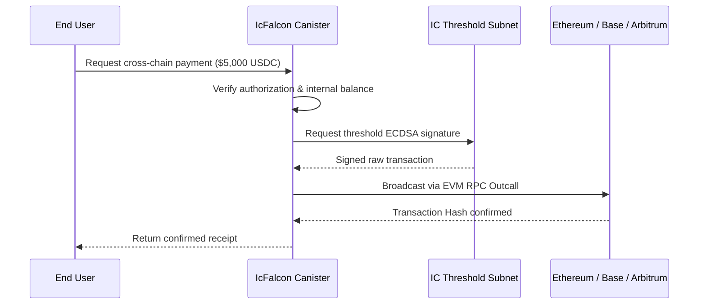

# The Ultimate Power of IcFalcon: Architecture, Capabilities & Real-World Scalability

> **IcFalcon** is an enterprise-grade, full-stack Internet Computer framework fusing a high-performance **Motoko 1.6.0** backend, **FalconORM (3NF Relational Database Engine)**, **Falcon Universe (Multi-Canister Event Mesh)**, and modern **Next.js 15.5+ / React 19** frontend powered by the `@icp-sdk` ecosystem.

---

## Executive Summary

Traditional software architectures force teams to choose between two painful compromises:
1. **Web2 Cloud Architectures (AWS / GCP / PostgreSQL)**: High database hosting costs, fragile multi-region sync, complex DevOps pipelines, centralized vendor lock-in, and constant security vulnerabilities (API keys, leaked database credentials, DDoS attacks).
2. **Traditional Blockchains (Ethereum / Solana / EVM L2s)**: Prohibitive gas fees per user click, no persistent in-memory database, inability to serve web frontends natively, 15-30 second finality, and total lack of native Web2 HTTP API interoperability.

**IcFalcon eliminates this compromise.** It transforms the Internet Computer into a serverless, persistent, self-authenticating supercomputer with zero database serialization overhead, micro-cent computational costs, native reverse-gas economics (users never pay gas fees), and sub-second global edge response times.

---

## Master Architecture Map

```mermaid
flowchart TD
    subgraph ClientLayer ["1. Global Edge Client Layer"]
        User["End User Browser / Mobile"]
        II["Internet Identity / WebAuthn Passkeys"]
        NextFrontend["Next.js 15.5+ / React 19 Static Frontend<br/>(@icp-sdk/core ^6.1 + @icp-sdk/auth ^11.2)"]
    end

    subgraph CanisterCore ["2. IcFalcon Core Canister (Enhanced Orthogonal Persistence)"]
        API["API Mixin Layer (api/v1/*)"]
        Services["Domain Service Layer (services/*)"]
        Repo["FalconORM Repositories (repositories/*)"]
        Storage["3NF In-Memory Persistence (storage/*)<br/>Auto-Synced Secondary Indices (BTreeMap)"]
    end

    subgraph ExternalWorld ["3. Falcon Universe & Global Interoperability"]
        Universe["Falcon Universe Event Mesh<br/>(Transactional Outbox + Idempotent Pub/Sub)"]
        HTTPOutcalls["Native HTTPS Outcalls<br/>(Stripe, OpenAI, Twilio, Webhooks)"]
        MultiChain["Threshold Cryptography (vetKeys & Multi-Chain)<br/>(Bitcoin, Ethereum/EVM, Solana)"]
        WorkerCanisters["Partitioned Worker Canisters (High Scale)"]
    end

    User -->|Passkey Auth| II
    II -->|Delegation Chain| NextFrontend
    NextFrontend -->|Direct Query/Update Calls (<100ms)| API
    API --> Services
    Services --> Repo
    Repo --> Storage
    Services -->|Emit Events| Universe
    Universe -->|Reliable Async Dispatch| WorkerCanisters
    Services -->|Consensus HTTP Outcall| HTTPOutcalls
    Services -->|Sign Transctions / Decrypt| MultiChain
```

---

## 1. Enhanced Orthogonal Persistence (EOP) with Motoko 1.6.0

### Technical Architecture
In traditional backends, data lives in RAM and must be continuously marshaled into SQL rows, JSON documents, or Redis keys. When an application crashes or restarts, all in-memory state is lost unless committed to a disk database.

In IcFalcon powered by Motoko 1.6.0 and Enhanced Orthogonal Persistence:
- **RAM is the Database**: Any Motoko data structure (`TrieMap`, `BTreeMap`, record, or class) declared in persistent storage remains in memory permanently.
- **Zero Serialization/Deserialization**: Canister upgrades do not require serializing gigabytes of state into stable memory buffers (`preupgrade`) and parsing them back (`postupgrade`). State is persisted directly at the WebAssembly memory page level with copy-on-write dirty page tracking.
- **64-bit Addressability**: Each canister supports up to **400 GiB** of stable memory via Motoko's `Region` API.

### Real-World Scalability Case Study: High-Frequency Order Book
- **Problem**: A crypto exchange processing 50,000 bids/asks per second cannot afford SQL query roundtrips (10–50ms latency) or Redis cache-invalidation bugs.
- **IcFalcon Solution**: The order book is maintained in pure Motoko in-memory balanced trees. Read queries resolve in **< 5ms** with zero database read replica costs. Upgrades to canister business logic occur in **sub-second time** without taking the exchange offline or dropping open orders.

---

## 2. FalconORM: 3NF Relational Database Engine in Pure Motoko

### Technical Architecture
FalconORM brings Third Normal Form (3NF) relational database rigor directly into pure Motoko:
- **Normalized Tables (`TableState<T>`)**: Primary keys guarantee uniqueness with O(1) direct access.
- **Auto-Synchronized Secondary Indices**: Indices on foreign keys (e.g. `userId`, `tenantId`, `status`) automatically insert, update, and remove references whenever entities change, avoiding index desynchronization.
- **Relational Integrity**: Built-in support for `hasMany` and `belongsTo` relations with fluent query builders:
  ```motoko
  let userOrders = OrderRepository.query()
    .where("userId", #equal, userId)
    .where("status", #equal, "COMPLETED")
    .orderBy("createdAt", #desc)
    .limit(50)
    .execute();
  ```
- **1-Line Declarative Migrations**: Schema evolutions are applied transactionally with migration version tracking.

### Real-World Scalability Case Study: Multi-Tenant Enterprise B2B SaaS
- **Problem**: Enterprise clients demand zero data leaks across tenants, composite index filtering, and strict audit trails.
- **IcFalcon Solution**: FalconORM partitions records by `tenantId` with composite secondary indices. A single canister can host 500,000 corporate invoices, querying tenant-specific statements in **sub-millisecond execution times** without running an external database cluster.

---

## 3. Falcon Universe Multi-Canister Event Mesh ("Kafka for Motoko")

### Technical Architecture
A single canister on the Internet Computer has computation limits per message execution round. To scale horizontally to billions of users, IcFalcon introduces **Falcon Universe**:
- **Distributed Event Bus**: An on-chain pub/sub messaging architecture connecting canisters across subnets.
- **Transactional Outbox Pattern**: State mutations and event emissions occur within the same atomic turn. If an error occurs, both roll back.
- **Deduplication & Idempotency**: Each message contains a unique `txId` and timestamp. Subscribing canisters verify event idempotency before processing, ensuring exactly-once execution semantics even under network retries.

```motoko
// Emitting a business event in IcFalcon
let event = Event.create("order.created", orderPayload);
Universe.publish(event);
```

### Real-World Scalability Case Study: Global Ride-Sharing / Logistics Mesh
- **Problem**: Tracking 2,000,000 active delivery drivers with real-time location updates, ride-matching, fare calculations, and payout ledger entries.
- **IcFalcon Solution**:
  - `Canister-Root`: Ingests passenger requests and driver pings.
  - `Canister-Shards (1..N)`: Partitioned by geographic region (e.g., North America, Europe, Asia) handling localized matching.
  - `Canister-Ledger`: Dedicated high-security canister reconciling balances.
  - Falcon Universe dispatches events between region shards asynchronously, achieving unlimited horizontal scaling.

---

## 4. Institutional Money Layer: Custodial Wallets & ICRC Standard

### Technical Architecture
IcFalcon comes pre-configured with a battle-tested financial primitives layer:
- **Pure Subaccount Derivation**: Generates deterministic 32-byte subaccounts for any principal using `subaccount.fromPrincipal`. No custom insecure hashing.
- **Multi-Token Support**: Native integration with ICP, ckBTC (Bitcoin on IC), ckETH (Ethereum on IC), and any ICRC-1/ICRC-2 token.
- **Double-Entry Reconciliation (`TxStore`)**: Every transfer creates matched debit and credit transaction records with immutable sequence IDs.
- **Idempotency Guard**: Rejects duplicate transfer attempts within expiration windows to eliminate double-spend hazards.

### Real-World Scalability Case Study: Global Neobank with 500,000 Active Accounts
- **Problem**: Generating unique deposit addresses for hundreds of thousands of users without paying custodial wallet creation gas fees.
- **IcFalcon Solution**: A single IcFalcon wallet canister derives 500,000 unique subaccounts at **zero computational cost**. Inbound deposits are detected, reconciled, and credited instantly with micro-cent ledger transaction fees ($0.0001 per transaction).

---

## 5. Threshold Cryptography & Multi-Chain Native Execution (`vetKeys`)

### Technical Architecture
Canisters in IcFalcon are not isolated to the Internet Computer. They act as autonomous cryptographic signatories:
- **Threshold ECDSA / Schnorr**: Canisters derive public keys and sign transactions for Bitcoin, Ethereum, Arbitrum, Base, and Solana without exposing private keys (keys are held collectively by IC node subnet threshold shares).
- **Verifiable Encrypted Threshold Keys (`vetKeys`)**: Canisters generate decryption keys for authorized principals, enabling on-chain encrypted storage where only the rightful owner can decrypt data.



### Real-World Scalability Case Study: Autonomous Cross-Chain Treasury
- **Problem**: Multi-sig wallets (like Gnosis Safe) require manual human signers for every transfer across chains, which is slow and vulnerable to social engineering.
- **IcFalcon Solution**: An IcFalcon governance canister programmatically disburses grants and manages liquidity across Ethereum and Solana using threshold signatures, verifying programmatic conditions on-chain with zero human intervention.

---

## 6. Native HTTPS Outcalls (Web2 API Interoperability)

### Technical Architecture
Unlike traditional smart contracts that require vulnerable third-party oracles (e.g. Chainlink), IcFalcon canisters can directly make standard HTTPS requests:
- **Sub-Consensus Replication**: Multiple nodes in the subnet execute the HTTP request simultaneously.
- **Transform Function**: Strips variable headers (e.g., timestamps, cookies) so all nodes agree on the canonical response body via cryptographic consensus.
- **Native Integrations**: Direct outcalls to OpenAI GPT-4o, Stripe API, Twilio SMS, AWS S3, GitHub, and Google APIs.

### Real-World Scalability Case Study: Automated AI Hedge Fund / Copilot
- **Problem**: Smart contracts cannot interact with generative AI models or consume Web2 financial data feeds without trusted middlemen.
- **IcFalcon Solution**: An IcFalcon service queries the OpenAI API via HTTPS outcalls, analyzes market sentiment or uploaded financial documents, and executes on-chain financial rebalancing based on the consensus response.

---

## 7. Strict 4-Tier Backend Layering Architecture

IcFalcon enforces an uncompromising architectural discipline designed to eliminate spaghetti code:

```
backend/src/
├── api/v1/          # Layer 1: Public Canister Endpoints (Thin mixins, DTOs, Auth check)
│   ├── Auth.mo
│   ├── Wallet.mo
│   └── Product.mo
├── services/        # Layer 2: Business Logic & Orchestration
│   ├── WalletService.mo
│   └── TransferService.mo
├── repositories/    # Layer 3: FalconORM Data Access & Indices
│   └── WalletRepository.mo
└── storage/         # Layer 4: Pure Persistent Memory State
    └── WalletStorage.mo
```

### Architectural Invariants:
1. **API layer never touches storage directly**: Always routes through services and repositories.
2. **Pure Services**: Service functions return `ApiResult<T, AppError>` with early-exit guards.
3. **Automated Static Audit**: `falcon audit code:motoko` verifies adherence to layering rules, syntax, and `mo:core` purity prior to compilation.

---

## 8. Modern Edge Frontend: Next.js 15.5+, React 19 & `@icp-sdk`

### Technical Architecture
The IcFalcon frontend is designed for world-class developer experience and production speed:
- **Next.js 15.5+ App Router**: Static export configuration (`output: "export"`) compiles the application into pure static assets served directly by the IC asset canister.
- **Zero Legacy SDK**: 100% migrated to `@icp-sdk/core` (`^6.1.1`), `@icp-sdk/auth` (`^11.2.0`), and `@icp-sdk/signer` (`^6.1.1`).
- **Tailwind CSS v4 & shadcn/ui**: Modern CSS-first tokenized components with instant dark-mode toggling.
- **SWR Client Caching**: Deduplicated, optimistic queries ensuring instant UI response times.

### Real-World Scalability Case Study: Censorship-Resistant Global Web Application
- **Problem**: Frontends hosted on AWS/Vercel are susceptible to domain takedowns, DNS hijacking, and server outages.
- **IcFalcon Solution**: The entire frontend is deployed on-chain across hundreds of boundary nodes. Assets are served over IPv6/IPv4 with HTTP/3 and TLS terminated via certified IC state, achieving **100% uptime with sub-100ms first-contentful paint globally**.

---

## 9. Reverse-Gas Economics & Micro-Cent Cycle Costs

### Cost Comparison Table

| Resource / Operation | Traditional Cloud (AWS) | Traditional Chain (Ethereum) | IcFalcon (Internet Computer) |
|---|---|---|---|
| **User Gas Fee** | $0 (Subscription) | $2.00 – $50.00 / tx | **$0.00 (Zero gas for users)** |
| **Data Storage (1 GB / year)** | $0.25 – $1.20 | $5,000,000+ | **~$5.00 / GB / year** |
| **Compute Turn (Update Call)** | $0.0001 (Serverless) | $1.00 – $25.00 | **~$0.000001 (100,000x cheaper)** |
| **Read Query Latency** | 50 – 200 ms | 15 – 60 seconds | **< 10 ms (In-memory query)** |
| **Web Server Hosting** | $20 – $500 / month | Impossible natively | **Included in canister cycles** |

---

## 10. AI-Native Framework Standards (`.agent/`)

IcFalcon is built from the ground up for human-AI collaborative software development:
- **61+ Curated AI Skills (`.agent/skills/`)**: Authoritative instruction manuals covering Motoko coding standards, cycle costs, ORM modeling, error handling, and frontend patterns.
- **Continuous Validation Tooling**:
  - `falcon sk:validate`: Validates skill structure, broken markdown links, and YAML frontmatter.
  - `falcon a:c:m`: Deep static code analysis checking Motoko style and layering.
  - `falcon p:check --local`: Full-stack automated verification (skills + Motoko audit + Wasm compilation + Next.js build).

---

## Summary: What Can You Build with IcFalcon?

With IcFalcon, a single developer or small team can build and operate systems that previously required entire engineering departments:

1. **Decentralized SaaS Applications**: Multi-tenant apps with subscription billing, team RBAC, and zero cloud hosting bills.
2. **Fintech Superapps & Payment Networks**: Custodial multi-token wallets with sub-cent transactions, subaccount isolation, and double-entry auditing.
3. **Cross-Chain Asset Managers**: Automated yield-farming, cross-chain swaps, and treasury management across Bitcoin, Ethereum, and Solana.
4. **AI Agents & Copilots**: On-chain agents with persistent memory, autonomous wallet custody, and direct access to external LLM APIs via HTTPS outcalls.
5. **Private Data Vaults**: End-to-end encrypted medical, legal, or personal identity management platforms using `vetKeys`.
